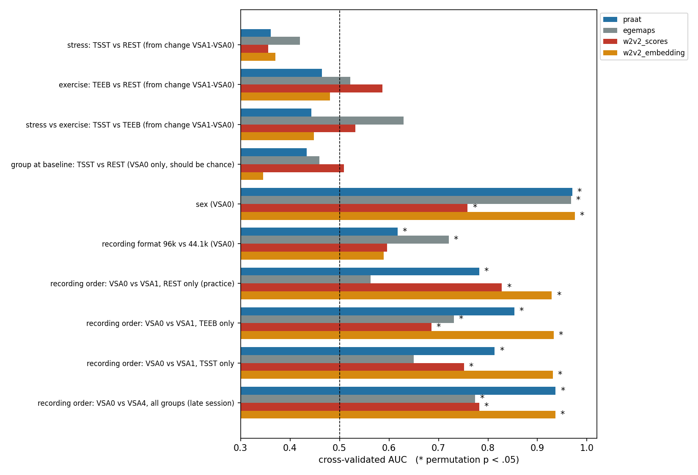

# Speech and Psychosocial Stress — Mannheim A03

Analysis code for the Mannheim A03 speech study (TU Dresden, Neuroimaging Center).

**Question.** Does acute psychosocial stress change the voice in standardized read speech? How does it compare with physical exercise and rest?

**Main finding.** The stressor produced a strong physiological response, but read speech showed no detectable vocal stress effect. The same methods do detect sex, speaker identity and practice effects.



---

## Result in brief

**Design**

- Three arms: TSST (psychosocial stress), TEEB (moderate cycling) and REST (newspaper reading); n ≈ 37 per arm.
- Each participant read the same text aloud five times; blood pressure and salivary cortisol were paired with each recording.

**Manipulation check.** At the post-task recording, TSST participants showed:

- systolic blood pressure +14 mmHg;
- cortisol +7.5 nmol/L.

**Voice**

- Mean F0 change, TSST − REST: −0.15 semitones [−0.44, +0.15].
- An equivalence test bounds any increase at ≤ +0.10 st.
- No effect in any of 115 handcrafted, eGeMAPS or wav2vec2-emotion features.
- Multivariate stress classification is at chance (AUC 0.36–0.42).

**Positive controls**

| Task | AUC |
|---|---:|
| Sex | 0.97 |
| Practice effect of one repeated reading (REST only) | 0.78–0.93 |
| Late session (VSA0 vs VSA4) | 0.94 |

Speaker re-identification: 96% rank-1.

The null therefore reflects the signal, not an insensitive method.

**Full report:** [`docs/final_report.md`](docs/final_report.md)

---

## Repository layout

```
├── README.md
├── requirements.txt
├── .gitignore                     # excludes all data, results and PRIVATE_* files
├── docs/
│   ├── final_report.md            # final results and interpretation
│   ├── decision_log.md            # analysis decisions and data audit (written before the group analyses)
│   ├── analysis_1b_report.md      # first-pass Step 1b report (superseded, kept for transparency)
│   └── figures/
└── src/
    ├── config.sh                  # shared paths (AUDIO_PROJECT, VENV, RESEARCH_MOUNT)
    ├── config.local.sh.example    # copy to config.local.sh for machine-specific values
    ├── a03_protocol_audit/        # Step 0: protocol / audio / SPSS linkage and QC
    ├── a03_features/              # Step 1a: acoustic feature extraction (blind)
    ├── a03_analysis_1b/           # Step 1b: hypothesis tests (H1–H3), sensitivity analyses
    └── a03_step2/                 # Step 2: wav2vec2 emotion model, positive controls, final contrasts
```

---

## Pipeline

Run the steps in order. Each step reads the previous step's outputs from `$AUDIO_PROJECT/results/`.

| Step | Command | What it does | Runtime |
|---|---|---|---|
| 0 | `bash src/a03_protocol_audit/run.sh` | Parses experiment protocols (xlsx), inventories wav files and cross-checks against SPSS: group labels, cortisol, blood pressure, timing | ~5 min |
| 1a | `bash src/a03_features/run.sh test`, then `… start` | Praat features (F0, jitter, shimmer, HNR, CPPS, pauses, reading time) and eGeMAPS, per stereo channel, at 16 kHz | ~15 min (16 workers) |
| 1b | `bash src/a03_analysis_1b/run.sh` | ANCOVA on change VSA1 − VSA0 (H1, H2a with TOST, H2b), mixed models (H3), 9 sensitivity analyses, exploratory tables, trajectory figure | ~1 min |
| 2 | `bash src/a03_step2/run.sh` | (a) zero-shot audEERING wav2vec2 arousal/dominance/valence (GPU); (b) positive controls, discrimination analyses, speaker identification, final contrasts with the 20–70 s duration rule | ~20 min |

**Options**

- `FORCE=1` overwrites existing results.
- `TRIALS_ROOT=…` and `SPSS=…` override the default input locations.
- Step 2 also accepts `run.sh w2v2` or `run.sh controls` to run only one part.

---

## Setup

```bash
git clone <this repository>
cd a03-speech-stress
pip install --upgrade-strategy only-if-needed -r requirements.txt
cp src/config.local.sh.example src/config.local.sh   # then edit the paths
```

`$AUDIO_PROJECT` is expected to contain:

```
data/raw/A03_FP1_VSA/.../trials/<DATE>_<ID>_<GROUP>/vsa/original/STE-00N.wav
data/raw/A03_FP1_VSA/.../trials/<DATE>_<ID>_<GROUP>/<DATE>_<ID>_<GROUP>.xlsx    # protocol
data/private_a03_metadata/Gesamt_A03_*.zip                                     # SPSS metadata
```

---

## Data and privacy

- **No data are included in this repository.** Audio, protocols, SPSS metadata and all participant-level outputs are restricted research data held at TU Dresden.
- **Output naming:**
  - `PRIVATE_*` files contain participant-level information. They stay on the authorized research storage and are git-ignored.
  - `*_PUBLIC.*` files contain group-level aggregates only. This naming does not replace institutional approval before anything is shared.
- **Pretrained model.** Step 2a downloads [`audeering/wav2vec2-large-robust-12-ft-emotion-msp-dim`](https://huggingface.co/audeering/wav2vec2-large-robust-12-ft-emotion-msp-dim) at run time. It is licensed CC BY-NC-SA 4.0 for research use only. Its weights are not redistributed here.

---

## Notes on analysis status

- The analysis plan was fixed and dated in advance (`docs/decision_log.md`) but **not pre-registered**. The data had been analysed previously in exploratory machine-learning experiments.
- Final numbers come from Step 2, which applies the 20–70 s duration rule. Step 1b results are kept for transparency; its conclusions are unchanged.

---

## Contact

Yunzhuo Dong · Neuroimaging Center, TU Dresden · Supervisor: Michael Marxen

## License

*To be decided* (add a `LICENSE` file before making the repository public).
