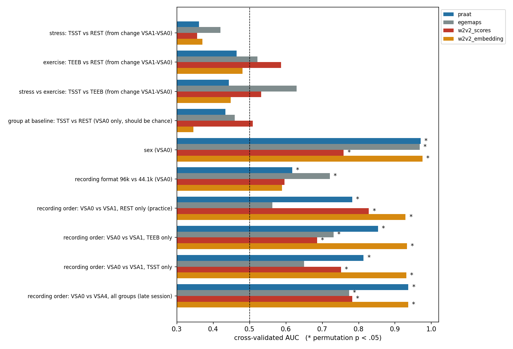

# Mannheim A03 — Speech and Stress: Final Report

**TU Dresden, Neuroimaging Center** · Researcher: Yunzhuo Dong · Supervisor: Michael Marxen
**Date:** 2026-11-12

**Status.** Final analysis. The plan was fixed in advance (decision log, 2026-11-06) but not pre-registered.

**Final numbers.** All numbers in this report come from Step 2. Step 2 applies the duration exclusion rule and supersedes Step 1b.

---

## 1. Summary

- **Question.** Does acute psychosocial stress (TSST) change the voice in a standardized reading task? How does it compare with physical exercise (TEEB) and rest (REST)?
- **The stressor worked.** At the moment of the post-task recording, TSST participants had:
  - systolic blood pressure **+14 mmHg** above baseline;
  - cortisol **+7.5 nmol/L** above baseline.
- **The voice did not change with stress.** Mean F0 change, TSST − REST = −0.15 semitones [−0.44, +0.15].
  - An equivalence test rules out any increase larger than **+0.10 st**.
  - 1 of 115 univariate stress tests reached uncorrected p < .05; none survived correction.
  - Multivariate classifiers were at chance (AUC 0.36–0.42).
  - The zero-shot audEERING emotion model also showed no effect.
- **The method is sensitive** (positive controls). The same features and classifiers:
  - detect sex (AUC 0.97);
  - re-identify speakers (96% rank-1);
  - detect the change between two consecutive readings in the REST group alone (AUC 0.78–0.93).
- **Conclusion.** The null is not due to an insensitive method. A strong, ongoing cardiovascular and endocrine stress response leaves no measurable trace in read speech recorded 1–3 minutes after the stressor.

---

## 2. Design and data

### 2.1 Arms

| Arm | Task | Physiological profile |
|---|---|---|
| TSST | Trier Social Stress Test | Sympathetic + HPA (cortisol) response |
| TEEB | 10 min ergometer cycling (2 min warm-up + 8 min moderate) | Sympathetic response, no HPA response |
| REST | Newspaper reading | Neither |

### 2.2 Recordings

The same standardized text was read aloud at each of five recordings (VSA0–VSA4, ~42 s each). Blood pressure was measured at each recording, and a salivary cortisol sample was paired with each recording.

| Recording | Timing (median, relative to task onset) | Paired cortisol | Role |
|---|---|---|---|
| VSA0 | ~−8 min | T1 | Baseline |
| VSA1 | +14 to +17 min (~1–3 min after the task ends) | T3 | Primary window |
| VSA2 | ~+40 min | T4 | Cortisol peak |
| VSA3 | ~+65 min | T5 | — |
| VSA4 | ~+167 min, after fMRI | T6 | — |

### 2.3 Sample

- **Primary sample** (VSA0 and VSA1 both available): **111 participants** — TSST 36, TEEB 36, REST 39.
- **Excluded recordings:** 6 of 574, by the duration rule (< 20 s or > 70 s; 5 too long, 1 too short).

### 2.4 Features

All features are means of the two stereo channels, computed after resampling to 16 kHz.

| Feature set | Content | Dimensions |
|---|---|---:|
| Praat (handcrafted) | F0 (semitones), jitter, shimmer, HNR, CPPS, intensity, pauses, reading time, estimated speech rate | 24 |
| eGeMAPS (openSMILE) | Standard acoustic parameter set | 88 |
| audEERING wav2vec2 emotion model (zero-shot) | Arousal, dominance, valence scores | 3 |
| Same model, mean-pooled embedding | Hidden-state representation | 1024 |

### 2.5 Statistics

- **Group contrasts.** ANCOVA on the change score (VSA1 − VSA0): change ~ group + baseline + sex + session start time + recording format.
- **Equivalence.** TOST with bounds ±0.5 st for F0.
- **Multivariate discrimination.**
  - Classifier: standardized features + L2 logistic regression (C = 0.1, no tuning).
  - Validation: participant-level 5-fold cross-validation, 20 repeats.
  - Significance: 300 label permutations.
- **Multiple comparisons.** Univariate tables are FDR-corrected within each feature family.

The full decision log, with rationale, is in [`decision_log.md`](decision_log.md) (2026-11-06).

---

## 3. Manipulation check

| Arm | ΔSBP at VSA1 (mmHg) | ΔHR during task (bpm)* | Δcortisol T4 − T1 (nmol/L) | Cortisol responders† |
|---|---:|---:|---:|---:|
| TSST | **+13.9** | +18 | **+7.5** | 78% |
| TEEB | +9.5 | **+31** | −2.2 | 27% |
| REST | +6.1 | +12 | −2.3 | 28% |

\* n = 66 with ECG. † max(T2–T4) − T1 ≥ 1.5 nmol/L.

Both manipulations produced the intended and distinct physiological profiles. The BP rise was measured at the same time as the VSA1 recording.

---

## 4. Main result: no vocal stress effect

### 4.1 Group contrasts on the change VSA1 − VSA0 (ANCOVA)

Each cell: estimate [95% CI], p.

| Outcome | TSST − REST | TSST − TEEB | TEEB − REST |
|---|---|---|---|
| **F0 mean (st)** — primary | −0.15 [−0.44, +0.15], p = .33 | −0.18 [−0.48, +0.11], p = .22 | +0.04 [−0.25, +0.33], p = .79 |
| F0 range (st) | −0.10 [−0.48, +0.28], p = .59 | +0.16 [−0.23, +0.55], p = .42 | −0.26 [−0.65, +0.12], p = .18 |
| CPPS (dB) | −0.06 [−0.20, +0.09], p = .45 | −0.07 [−0.22, +0.07], p = .33 | +0.02 [−0.13, +0.16], p = .81 |
| Reading time (s) | −0.15 [−1.80, +1.50], p = .86 | +0.95 [−0.73, +2.63], p = .26 | −1.10 [−2.75, +0.55], p = .19 |
| w2v2 arousal | −0.008 [−0.026, +0.009], p = .35 | +0.008, p = .38 | −0.017 [−0.035, +0.001], p = .07 |
| w2v2 dominance | −0.004, p = .54 | +0.008, p = .27 | −0.012, p = .08 |
| w2v2 valence | −0.004, p = .49 | +0.001, p = .84 | −0.006, p = .37 |

### 4.2 Equivalence tests (F0 mean, bounds ±0.5 st)

| Contrast | 90% CI | p_TOST | Conclusion |
|---|---|---:|---|
| TSST − REST | [−0.39, +0.10] | .009 | Equivalent |
| TSST − TEEB | [−0.43, +0.07] | .018 | Equivalent |

### 4.3 Supporting analyses (Step 1b; consistent with the above)

- **Sensitivity analyses.** Nine variants agree: HC3 standard errors, Huber regression, baseline-only model, exclusion of flagged participants, timestamp-verified subset, single-channel features, and others. All have p ≥ .32 for TSST − REST.
- **Arousal adjustment.** Adding ΔSBP or ΔHR does not reveal a masked effect.
- **Within-person coupling (mixed model, 5 recordings).** F0 does not track SBP (+0.001 st/mmHg, p = .59) or log-cortisol (p = .20).

### 4.4 Exhaustive search

Across all 115 features (24 Praat + 88 eGeMAPS + 3 w2v2), TSST − REST:

- 1 test with uncorrected p < .05 (about 6 expected by chance);
- 0 tests with FDR q < .05.

Multivariate TSST vs REST discrimination from the change scores:

| Feature set | AUC | Permutation p |
|---|---:|---:|
| Praat | 0.36 | .96 |
| eGeMAPS | 0.42 | .85 |
| w2v2 scores | 0.36 | .92 |
| w2v2 embedding | 0.37 | .94 |

---

## 5. Positive controls: what the features can detect

Cross-validated AUC, with permutation p in parentheses.

| Task | Praat | eGeMAPS | w2v2 scores | w2v2 embedding |
|---|---|---|---|---|
| **Sex** (VSA0) | **0.97** (.003) | **0.97** (.003) | 0.76 (.003) | **0.98** (.003) |
| **Practice:** VSA0 vs VSA1, REST only | **0.78** (.007) | 0.56 (.32) | **0.83** (.003) | **0.93** (.003) |
| VSA0 vs VSA1, TEEB only | 0.85 (.003) | 0.73 (.017) | 0.69 (.037) | 0.93 (.003) |
| VSA0 vs VSA1, TSST only | 0.81 (.003) | 0.65 (.11) | 0.75 (.003) | 0.93 (.003) |
| **Late session:** VSA0 vs VSA4 | **0.94** (.003) | 0.77 (.003) | 0.78 (.003) | **0.94** (.003) |
| Recording format (96 vs 44.1 kHz) | 0.62 (.05) | 0.72 (.003) | 0.60 (.07) | 0.59 (.14) |
| Exercise: TEEB vs REST (Δ) | 0.47 (.64) | 0.52 (.39) | 0.59 (.13) | 0.48 (.55) |
| Stress vs exercise: TSST vs TEEB (Δ) | 0.44 (.73) | 0.63 (.053) | 0.53 (.34) | 0.45 (.71) |
| **Stress: TSST vs REST (Δ)** | **0.36** (.96) | **0.42** (.85) | **0.36** (.92) | **0.37** (.94) |
| Sanity: TSST vs REST at baseline (should be chance) | 0.43 (.78) | 0.46 (.67) | 0.51 (.43) | 0.35 (.98) |

**Speaker identification** (VSA1 matched to the same person's VSA0 among 111 speakers; chance = 0.9%):

| Feature set | Rank-1 accuracy | Top-5 accuracy |
|---|---:|---:|
| Praat | 50% | 77% |
| eGeMAPS | 82% | 91% |
| w2v2 scores | 11% | 33% |
| w2v2 embedding | **96%** | 99% |

### 5.1 Interpretation

1. **Speaker identity and sex.** These dominate the acoustic representation, which is expected.

2. **Within-person change is detectable.** The second reading of the same text (REST, no intervention) differs systematically from the first:
   - wider F0 range (+0.47 st, dz = 0.53) and larger F0 SD (dz = 0.57);
   - faster reading (−1.5 s);
   - higher arousal and dominance scores from the emotion model (dz = 0.71–0.74).

   These practice effects are even stronger by VSA4. So the pipeline detects subtle state changes within a person.

3. **TSST adds nothing beyond practice.** The TSST pre–post changes are significant within the group (F0 SD, F0 range, CPPS, w2v2 scores), but they are the same size as in REST. Once the practice effect is subtracted, no stress effect remains.

4. **Recording format is partly detectable.** Most affected are pause measures, shimmer, HNR and the Hammarberg index. Format is confounded with year (and therefore with participant cohort), is constant within 115 of 116 participants, and is a covariate in all models. It cannot explain the stress null, but it limits between-person comparisons.

---

## 6. Exercise (TEEB): a consistent trend, not a confirmed effect

After cycling, participants read with:

- less phonation time (−5.0 s);
- slower speech (−0.44 syll/s);
- more pausing (+4.1 s total pause; pause ratio +0.10);
- higher intensity (+2.0 dB).

All four effects point in the direction expected from post-exercise respiratory load (d_adj = 0.48–0.62, uncorrected p = .01–.05). However, none survives FDR correction (q ≥ .12), and multivariate TEEB vs REST discrimination is at chance.

The emotion model gives TEEB a *smaller* practice-related rise in arousal and dominance than REST (−0.017, p = .07), not a larger one.

**Conclusion.** There is suggestive, coherent evidence that exercise affects speech breathing, but the effect is not established in this sample.

---

## 7. Why this is a strong negative result

1. **The manipulation worked, at the moment of recording.** Cortisol +7.5 nmol/L; SBP +14 mmHg measured during the VSA1 recording.
2. **Equivalence, not just non-significance.** The F0 increase is bounded at ≤ +0.10 st, and the point estimate is negative.
3. **High measurement precision.**
   - The F0 baseline–post correlation is 0.993.
   - ΔF0 is reliable across the two microphone channels (r = 0.985).
   - The design had 80% power for ~0.4 st.
4. **The method is demonstrably sensitive.** It detects the practice effect of a single repeated reading (AUC 0.78–0.93) but not psychosocial stress (AUC 0.36–0.42).
5. **Converging evidence.** Every level of analysis is null for stress: hypothesis-driven outcomes, 115 exploratory features, four multivariate feature sets, a pretrained emotion model, arousal-adjusted models, and within-person physiological coupling.
6. **Robustness.** Results hold across nine analytic variants, the duration exclusion rule and both microphone channels.
7. **It explains the earlier failures.** Experiments D1–D5 (deep and classical classifiers) failed because there is no group-level stress signal in these recordings, not because of model choice.

---

## 8. Limitations

- **Task.** Standardized reading only. Published TSST voice effects mostly come from the spontaneous TSST speech itself. Read speech of a familiar text may be resistant to stress-related prosodic change.
- **Timing.** VSA1 was recorded ~1–3 min *after* the stressor, not during it. Autonomic arousal was still elevated, but the social-evaluative situation had ended.
- **Equivalence bound.** The ±0.5 st bound still needs to be justified against published TSST F0 effect sizes.
- **Sample size.** ~37 per arm. Effects below ~0.4 st (d < 0.65) could not be detected with high power in the between-group contrasts. The equivalence interval nevertheless excludes increases above 0.10 st.
- **Recording format.** Format varies across years and is detectable from the features; it is handled as a covariate.
- **Reused data.** The data were analysed previously (D1–D5, Task A). This analysis was planned and dated in advance but not pre-registered.
- **Within-group heterogeneity.** Individual responses in opposite directions could cancel at the group level. There is no evidence for this: the ΔF0 SD is not larger in TSST (0.61) than in REST (0.73).

---

## 9. Conclusions and recommendations

**Conclusion.** In a three-arm design with verified physiological stress responses, standardized read speech recorded shortly after the TSST shows no detectable vocal signature of psychosocial stress. This holds for handcrafted acoustics, eGeMAPS and a pretrained wav2vec2 emotion model. The same tools readily detect sex, speaker identity and practice effects. Voice-based stress detection therefore appears to depend on the speaking situation (spontaneous, socially evaluated speech) rather than on the presence of a physiological stress state.

**Recommendations for future work**

1. Analyse speech recorded **during** the TSST (spontaneous speech), if recordings exist. This is where the literature reports effects.
2. Use within-person designs with matched spontaneous speech at baseline and under stress.
3. Test the exercise–breathing hypothesis directly, with breath-pause detection, in an independent sample.
4. Stop optimizing classifiers for TSST detection from these reading recordings. The positive controls show that the limitation lies in the signal, not the models.

---

## 10. Files

All paths are relative to `$AUDIO_PROJECT`. Only `*_PUBLIC` outputs are shareable.

| Step | Script | Results |
|---|---|---|
| 0 — protocol / audio / SPSS audit | `src/a03_protocol_audit/` | `results/a03_protocol_audit_v2/` |
| 1a — feature extraction | `src/a03_features/` | `results/a03_features_v1/` |
| 1b — group analysis (superseded by Step 2 for final numbers) | `src/a03_analysis_1b/` | `results/a03_analysis_1b_v1/` |
| 2 — emotion model + positive controls + final contrasts | `src/a03_step2/` | `results/a03_w2v2_emotion_v1/`, `results/a03_positive_controls_v1/` |
